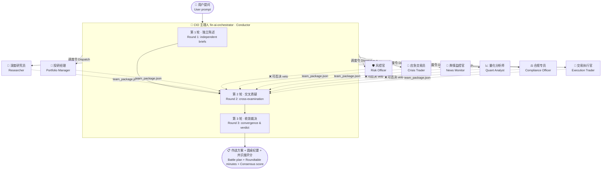

# 🌍 普惠金融数字员工团队 · FinAI Digital Workforce

> **9 个 AI 数字员工组成一支投研团队**——不是 9 个孤立工具，而是一支会**开会、互相质疑、投票、弃权、最后由 CIO 拍板**的智能体队伍。
>
> **Nine AI digital employees running as ONE investment committee** — they debate, cross-examine, vote, abstain, and escalate to a CIO arbiter.

<p align="center">
  
  
  
  
  
</p>

<p align="center">
  <b>🏆 2026 腾讯云黑客松 AI 智能体争霸赛 · 全球二等奖</b><br>
  <b>🏆 2026 Tencent Cloud Hackathon — AI Agent Competition, Global 2nd Prize</b><br>
  <i>受邀于腾讯全球数字生态大会展示 · Showcased at Tencent Global Digital Ecosystem Summit</i>
</p>

[English README / 英文版 →](README_EN.md)

---

## 🧠 核心不是 9 个工具，是「群体智能」 Collective Intelligence

大多数 Agent 项目把多个角色平铺输出，各说各话，结果就是**一堆平行报告**。
我们解决的是**如何让 9 个 Agent 真正像一个投委会那样协作**。

Most agent projects simply aggregate parallel reports from several roles. We asked a harder question:
**how can nine agents genuinely behave like an investment committee?**

### 五个关键机制 / Five Mechanisms That Make It Work

| # | 机制 Mechanism | 中文说明 | What it does (EN) |
|:--:|---|---|---|
| 1 | 🪑 **圆桌讨论 Roundtable** | CIO 主理人召集 3 轮会议：独立陈述 → 交叉质疑 → 收敛定案 | Three rounds: independent briefs → cross-examination → convergence |
| 2 | ⚔️ **对抗式交叉质疑 Adversarial Review** | 风控官有权**否决**研究员估值；合规专员能否决整笔交易；量化分析师负责校准两者的模型假设 | Risk officer can veto the researcher's valuation; compliance can veto the trade; quant audits both models' assumptions |
| 3 | 🖐️ **弃权权 Right to Abstain** | 任一员工数据不足时可 `abstain: true` 弃权——**沉默的好过编造的**；弃权必须写明原因，且主理人要降级采信 | Any employee may abstain when data is insufficient. An honest abstention outranks a fabricated number |
| 4 | 📊 **共识度评分 Consensus Scoring** | 主理人对 9 份意见做加权汇总，输出 `consensus_score`；低共识时自动降级为"观察名单"而非强行给结论 | Weighted aggregation produces a consensus score; low consensus auto-downgrades to "watchlist" instead of forcing a call |
| 5 | 📦 **统一数据契约 Shared Data Contract** | 所有员工上报 `team_package.json`（同一 schema），让协作**可编程、可回放、可审计**，而不是靠自然语言互相理解 | Every employee emits the same JSON contract, making collaboration machine-checkable and replayable |

> **一句话总结**：单个员工负责"专业深度"，主理人负责"组织智商"。
> Individual employees own **depth**; the orchestrator owns **organizational IQ**.

### 群体智能运行流 / How a decision flows



---

## 👥 9 名数字员工 / Meet the Team

| 花名 · Role | 目录 · Directory | 核心能力 · Superpower | 关键算法/规则 · Core Method |
|---|---|---|---|
| 🎼 **CIO 主理人**<br/>CIO Orchestrator | `fin-ai-orchestrator/` | 3 轮圆桌会议、任务路由、加权裁决、共识度评分 | Consensus engine + veto arbitration |
| 🔬 **深度研究员**<br/>Deep Researcher | `fin-ai-researcher/` | 单股深度研究、多方法估值、敏感性分析 | DCF / PE / PB / DDM + 蒙特卡洛 (10k, seed 42) |
| 💼 **投研经理**<br/>Portfolio Manager | `fin-ai-portfolio/` | 组合全局视图、业绩归因、调仓建议 | Brinson 三因子归因 + 资产配置分析 |
| 🛡️ **风控官**<br/>Risk Officer | `fin-ai-risk/` | 组合风险扫描、极端情景推演、三级预警 | VaR (历史/参数) + 压力测试 + 相关性矩阵 |
| 🚨 **应急交易员**<br/>Crisis Trader | `fin-ai-crisis/` | **5 分钟**突发事件处置：分级→匹配案例→减仓 | 舆情分级 + 历史案例库匹配 + 一键模拟试单 |
| 📡 **舆情监控官**<br/>News Monitor | `fin-ai-news/` | 7×24 扫描、自动分级、相似历史案情比对 | 情绪×传播×监管 三维打分 + 案例库检索 |
| 📈 **量化分析师**<br/>Quant Analyst | `fin-ai-quant/` | 因子归因、组合优化、模型假设校准 | Fama-French + Black-Litterman + Markowitz |
| ⚖️ **合规专员**<br/>Compliance Officer | `fin-ai-compliance/` | 信披合规、关联交易识别、投资者保护 | 规则驱动 `rules.json`（含法条号）+ 审计日志 |
| 🎯 **交易执行官**<br/>Execution Trader | `fin-ai-execution/` | 算法下单、冲击成本测算、模拟撮合 | TWAP / VWAP / POV / Iceberg / Sniper |

> 每名员工既可**单兵作战**（单独安装），也可加入团队接受主理人调度。
> Each employee works **standalone** or joins the team under the orchestrator.

---

## ⚡ 快速开始 / Quick Start

```bash
git clone https://github.com/jameszeng809/fin-ai-workforce.git
cd fin-ai-workforce

# 无需 pip install 即可使用数据层（零依赖）
python shared/fin_data.py quote sh600519        # 实时行情 realtime quote
python shared/fin_data.py kline sh600519 --days 250
python shared/fin_data.py finance sh600519      # 财务指标 financials
python shared/fin_data.py list                  # 全部端点 all endpoints
```

把任意员工目录复制到你的 Agent 技能目录（如 WorkBuddy `~/.workbuddy/skills/`），或按其 `SKILL.md` 安装即可使用。

Copy any employee folder into your agent's skills directory (e.g. WorkBuddy `~/.workbuddy/skills/`), or follow the install section inside its `SKILL.md`.

**可选增强（均无需 API Key）：**

```bash
pip install -r requirements.txt      # akshare (A股深度) + yfinance (港美股) + matplotlib (图表)
```

---

## 🔌 数据源：为什么这里没有 API Key / Data Layer

本团队**不依赖任何私有数据连接器**。`shared/fin_data.py` 是一个统一数据层，内置三级通道：

| 通道 Tier | 覆盖范围 Coverage | 依赖 Requirement | 需要 Key？ |
|---|---|---|:--:|
| **L1 公开数据源** | 行情 / K线 / 技术指标 / 财务 / 股东 / 新闻 / 指数 / 板块 | 无（Python 标准库） | ❌ |
| **L2 AKShare** | A股深度：龙虎榜 / 融资融券 / 筹码分布 / 分红 / 北向资金 | `pip install akshare` | ❌ |
| **L3 yfinance** | 港美股深度数据 | `pip install yfinance` | ❌ |

```python
from shared import fin_data
r = fin_data.call("quote", "hk00700")
# {'status': 'ok', 'source': 'L1:eastmoney', 'data': {...}, ...}
```

### 🛡️ 数据诚实原则 — 本项目的底线 / Honesty Contract

每一次数据调用都返回 `status`：`ok` / `degraded` / `unavailable`。
凡 `degraded` 或 `unavailable` 的字段，**必须在报告中显式披露**，禁止用估算值静默填充。

Every call returns `status`. Anything that is not `ok` **must be surfaced in the report** — never silently backfilled.

> *宁可给出"该方法不适用"的专业结论，也不用一个数学上成立、经济上荒谬的假设编出精确到小数点的目标价。*
> *We would rather publish "this method does not apply" than produce a precise-looking target price built on absurd assumptions.*

这条原则在研究员身上真实发生过：贵州茅台回归 β = **-0.20**、R² = **0.033**，导致 WACC ≈ 0.55% < 永续增长率 g = 3%。我们没有修数字，而是让 `dcf.py` 触发**护栏模式**并在报告中声明"DCF 因 β 异常不适用，主结论改用相对估值"。
Real case: Kweichow Moutai regressed to β = **-0.20**, R² = **0.033** → WACC ≈ 0.55% < g = 3%. The DCF script raised a guardrail and the report switched to relative valuation instead of faking a number.

---

## 📁 目录结构 / Repository Layout

```
fin-ai-workforce/
├── fin-ai-orchestrator/     🎼 CIO 主理人（含全队共用的数据契约 schema）
├── fin-ai-researcher/       🔬 深度研究员
├── fin-ai-portfolio/        💼 投研经理
├── fin-ai-risk/             🛡️ 风控官
├── fin-ai-crisis/           🚨 应急交易员
├── fin-ai-news/             📡 舆情监控官
├── fin-ai-quant/            📈 量化分析师
├── fin-ai-compliance/       ⚖️ 合规专员
├── fin-ai-execution/        🎯 交易执行官
├── shared/                  🌐 统一数据层 fin_data.py（零依赖核心）
├── templates/               📄 持仓清单等模板
├── tools/                   🛠️ 自检 & 迁移脚本
└── docs/                    📚 群体智能设计说明
```

每个员工目录内含：`SKILL.md`（角色定义与流水线）· `scripts/`（纯标准库计算脚本）· `data/`（本地规则库）· `README.md`（中英介绍）。

> **为什么所有计算脚本只用标准库？**
> 旧版脚本依赖 numpy，在未安装的开箱环境直接 `ModuleNotFoundError`，导致"禁止 LLM 心算、必须跑脚本"的流水线整体断裂。现在全部改为**纯 Python 标准库**，任何 Python 3.8+ 环境开箱即用。

---

## 🎤 路演亮点 / Demo Highlights

| 亮点 | 看点 |
|---|---|
| 🎼 **现场跑圆桌会议** | 输入一个问题，看 9 个员工现场开会、互相否决、CIO 加权裁决 |
| 🖐️ **看 AI 主动弃权** | 数据不足时明确说"我不发表意见"，而不是硬凑结论 |
| 💰 **β 异常触发护栏** | 展示"宁可承认模型不适用，也不编目标价"的专业克制 |
| 🎯 **从研究到下单闭环** | 研究员给估值 → 风控官给仓位上限 → 交易执行官拆单，全程数据契约贯通 |
| 🌐 **零 Key 全球可跑** | 任何人 clone 下来就能拉到真实行情，不需要注册任何账号 |

---

## 📜 开源协议 / License

[MIT License](LICENSE) © 2026 jameszeng809

## ⚠️ 免责声明 / Disclaimer

本项目输出**仅供参考，不构成任何投资建议**。所有计算结果基于公开数据，含合理假设；
历史业绩不代表未来表现；任何投资决策均由使用者自行判断。
This project is for research and education only. It is **not investment advice**. Use at your own discretion.

---

<p align="center">
  <i>如果这个项目对你有启发，点个 ⭐ Star 让更多人看到群体智能的可能。</i><br>
  <i>If this sparks something, drop a ⭐ — it helps others discover what collective agents can do.</i>
</p>
