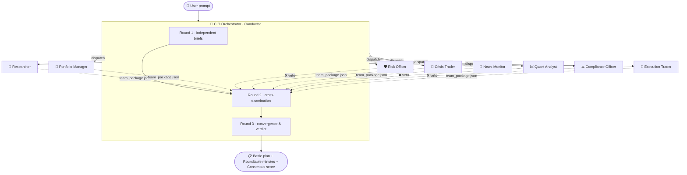

# 🌍 FinAI Digital Workforce · 普惠金融数字员工团队

> **Nine AI digital employees running as ONE investment committee** — not nine parallel tools, but a team that **debates, cross-examines, votes, abstains, and escalates to a CIO arbiter**.

<p align="center">
  
  
  
  
  
</p>

<p align="center">
  <b>🏆 2026 Tencent Cloud Hackathon — AI Agent Competition, Global 2nd Prize</b><br>
  <b>🏆 2026 腾讯云黑客松 AI 智能体争霸赛 · 全球二等奖</b><br>
  <i>Showcased at Tencent Global Digital Ecosystem Summit</i>
</p>

[中文 README →](README.md)

---

## 🧠 The point is not nine tools — it is collective intelligence

Most agent repositories bolt a few roles together and emit parallel reports that never talk to each other. We set out to build something harder: **an agent team that behaves like a real investment committee**.

### Five mechanisms that make it real

| # | Mechanism | What happens | 中文
|:--:|---|---|---|
| 1 | 🪑 **Roundtable** | The CIO orchestrator runs three rounds: independent briefs → adversarial cross-examination → convergence and verdict | 三轮圆桌讨论 |
| 2 | ⚔️ **Adversarial review** | The risk officer can **veto** the researcher's valuation; compliance can veto the entire trade; the quant audits both models' assumptions | 交叉质疑与否决权 |
| 3 | 🖐️ **Right to abstain** | Any employee may return `abstain: true` when its data is insufficient — **an honest silence beats a fabricated number** | 数据不足时主动弃权 |
| 4 | 📊 **Consensus scoring** | The orchestrator aggregates nine opinions into a `consensus_score`; low consensus downgrades the answer to a *watchlist* instead of forcing a call | 共识度评分与自动降级 |
| 5 | 📦 **Shared data contract** | Every employee emits the same `team_package.json` schema, so cooperation is machine-checkable, replayable and auditable — not a matter of mutual "understanding" in prose | 统一数据契约 |

> **In one line:** individual employees own **depth**; the orchestrator owns **organizational IQ**.
> **一句话总结**：单个员工负责"专业深度"，主理人负责"组织智商"。

### How one decision flows



---

## 👥 Meet the team

| Role | Directory | Superpower | Core method |
|---|---|---|---|
| 🎼 **CIO Orchestrator** | `fin-ai-orchestrator/` | Three-round roundtable, routing, weighted arbitration | Consensus engine + veto arbitration |
| 🔬 **Deep Researcher** | `fin-ai-researcher/` | Single-name deep dive, multi-method valuation | DCF / PE / PB / DDM + Monte Carlo (10k, seed 42) |
| 💼 **Portfolio Manager** | `fin-ai-portfolio/` | Portfolio view, performance attribution, rebalancing | Brinson attribution + asset allocation |
| 🛡️ **Risk Officer** | `fin-ai-risk/` | Portfolio risk scan, stress testing, 3-tier alerts | VaR + stress testing + correlation matrix |
| 🚨 **Crisis Trader** | `fin-ai-crisis/` | **5-minute** incident response for breaking news | Severity grading + case-library matching + paper trade |
| 📡 **News Monitor** | `fin-ai-news/` | 24/7 scanning, auto-triage, precedent comparison | Sentiment × reach × regulatory weighting |
| 📈 **Quant Analyst** | `fin-ai-quant/` | Factor attribution, optimization, assumption audit | Fama-French + Black-Litterman + Markowitz |
| ⚖️ **Compliance Officer** | `fin-ai-compliance/` | Disclosure rules, related-party detection, investor protection | Rule-driven `rules.json` + audit trail |
| 🎯 **Execution Trader** | `fin-ai-execution/` | Algorithmic order slicing, impact cost, paper trading | TWAP / VWAP / POV / Iceberg / Sniper |

Each employee runs **standalone** or joins the team under the orchestrator's dispatch.

---

## ⚡ Quick start

```bash
git clone https://github.com/jameszeng809/fin-ai-workforce.git
cd fin-ai-workforce

# The data layer needs zero third-party packages:
python shared/fin_data.py quote sh600519        # realtime quote
python shared/fin_data.py kline sh600519 --days 250
python shared/fin_data.py finance sh600519
python shared/fin_data.py list                  # all endpoints
```

To use an employee, copy its folder into your agent's skills directory (for example WorkBuddy's `~/.workbuddy/skills/`) or follow the install section in its `SKILL.md`.

**Optional upgrades (still no API key):**

```bash
pip install -r requirements.txt      # akshare (deep A-share) + yfinance (HK/US) + matplotlib (charts)
```

---

## 🔌 Data layer — why there is no API key here

The team does **not** depend on any proprietary data connector. `shared/fin_data.py` exposes a unified layer over three tiers:

| Tier | Coverage | Requirement | Key? |
|---|---|---|:--:|
| **L1 public endpoints** | Quote / K-line / indicators / financials / holders / news / index / sectors | Python standard library only | ❌ |
| **L2 AKShare** | Deep A-share: dragon-tiger list / margin trading / chip distribution / dividends / northbound flows | `pip install akshare` | ❌ |
| **L3 yfinance** | Deep HK & US equity data | `pip install yfinance` | ❌ |

```python
from shared import fin_data
r = fin_data.call("quote", "hk00700")
# {'status': 'ok', 'source': 'L1:eastmoney', 'data': {...}, ...}
```

### 🛡️ The honesty contract — our red line

Every call returns `status`: `ok` / `degraded` / `unavailable`. Anything that is not `ok` **must be surfaced in the report**. We never silently backfill with estimates.

> *We would rather publish "this method does not apply" than produce a precise-looking target price built on absurd assumptions.*

This is not a slogan — it happened during development. Regressing Kweichow Moutai (600519) returned β = **-0.20** with R² = **0.033**, pushing WACC to ≈ 0.55%, below the perpetual growth rate g = 3%. We did not massage the inputs. `dcf.py` triggers a **guardrail**, and the report states: *DCF is not applicable due to an abnormal β — the primary conclusion relies on relative valuation.*

---

## 📁 Repository layout

```
fin-ai-workforce/
├── fin-ai-orchestrator/     🎼 CIO Orchestrator (hosts the shared data contract)
├── fin-ai-researcher/       🔬 Deep Researcher
├── fin-ai-portfolio/        💼 Portfolio Manager
├── fin-ai-risk/             🛡️ Risk Officer
├── fin-ai-crisis/           🚨 Crisis Trader
├── fin-ai-news/             📡 News Monitor
├── fin-ai-quant/            📈 Quant Analyst
├── fin-ai-compliance/       ⚖️ Compliance Officer
├── fin-ai-execution/        🎯 Execution Trader
├── shared/                  🌐 Unified data layer fin_data.py
├── templates/               📄 Watchlist & position templates
├── tools/                   🛠️ Self-check & migration scripts
└── docs/                    📚 Collective intelligence design notes
```

Each employee ships: `SKILL.md` (role & pipeline) · `scripts/` (stdlib-only calculators) · `data/` (local rule packs) · `README.md` (bilingual guide).

> **Why every calculator uses the standard library only?**
> An earlier version depended on numpy. On any machine without it, the whole "scripts must run, no mental math" pipeline died with `ModuleNotFoundError`. Everything is now **pure Python 3.8+ stdlib**.

---

## 🎤 Demo highlights

| Highlight | Why judges care |
|---|---|
| 🎼 **Live roundtable** | Pose one question and watch nine employees confer, veto each other, and let the CIO arbitrate |
| 🖐️ **Watch an AI abstain** | When data is thin, it says "no opinion" instead of inventing a conclusion |
| 💰 **The β guardrail** | Shows professional restraint: admitting the model does not apply beats faking a target price |
| 🎯 **Research → risk → execution loop** | One data contract carries the decision from valuation to position sizing to order slicing |
| 🌐 **Zero-key, runs anywhere** | Clone and fetch real quotes without signing up for anything |

---

## 📜 License

[MIT License](LICENSE) © 2026 jameszeng809

## ⚠️ Disclaimer

Outputs are for **research and demonstration only and are not investment advice**. Results derive from public data with reasonable assumptions; past performance does not predict future results. You make your own calls.

---

<p align="center">
  <i>If this sparks something, drop a ⭐ — it helps others discover what collective agents can do.</i>
</p>
